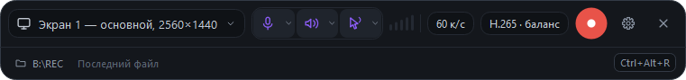
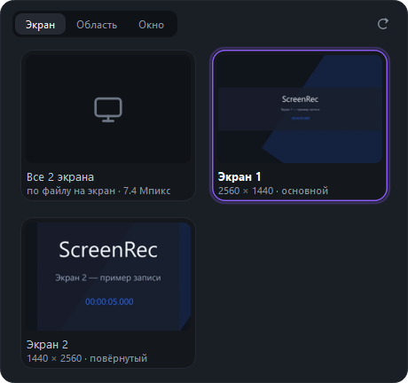
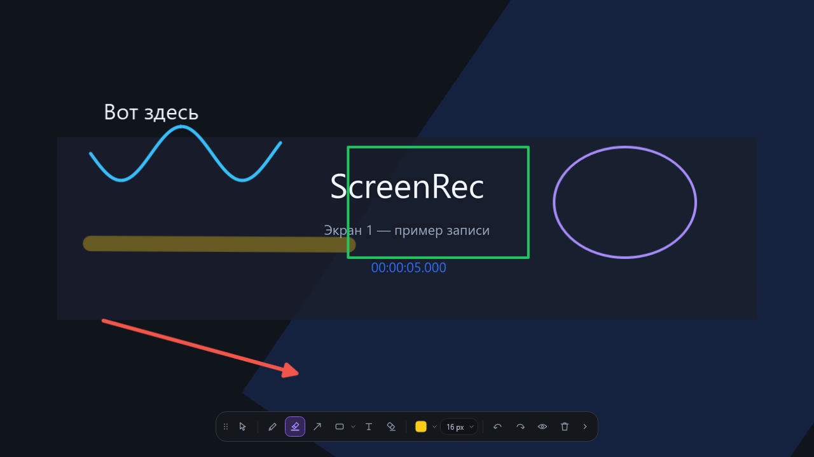
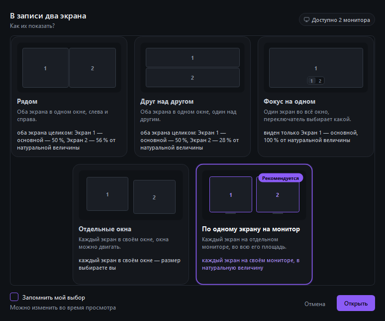
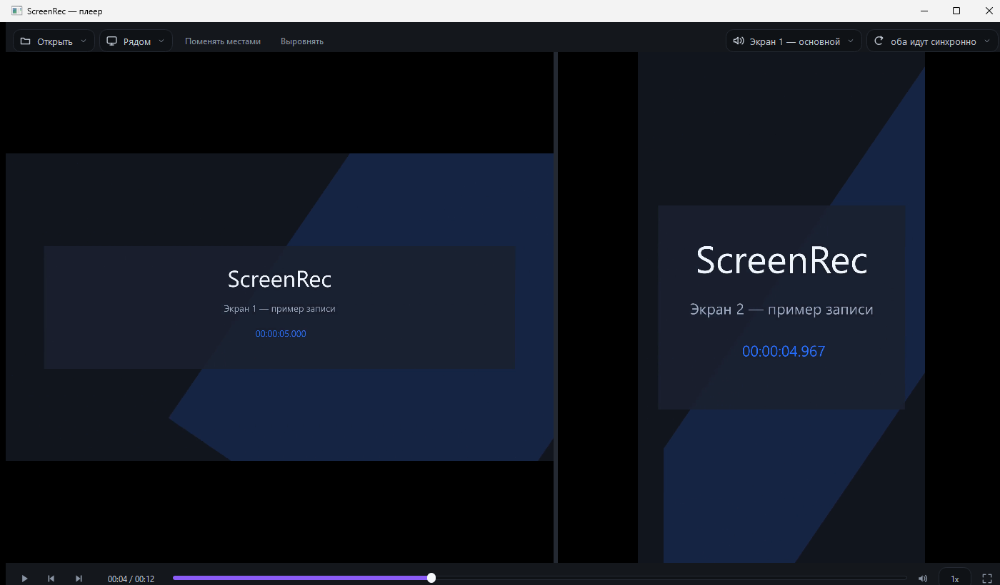
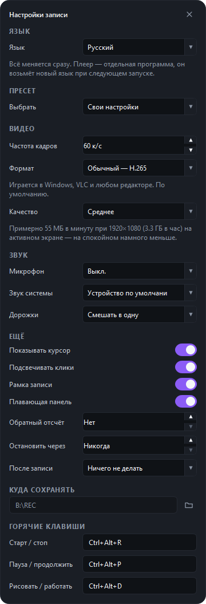

# ScreenRec

A Windows screen recorder, and a player for what it records. Recording only — no
editor, no timeline, no export presets, no account, no network. It captures a monitor, a
dragged-out region, a single window, or **every screen at once**, with the microphone
and the system sound, and stops on a global hotkey.

Written because the recorder it replaces would not install, and because the half of that
program that mattered was the capture.



While it records it gets out of the way — a clock, the size of the file so far, and
the frame rate it is really achieving:


## Installing

Download `ScreenRec-0.1.0-setup.exe` from [Releases](../../releases) and run it. It
installs both programs into `C:\Program Files\ScreenRec`, puts **ScreenRec** and
**ScreenRec Player** in the Start menu, and asks once where recordings should go.
Nothing else is needed: ffmpeg is inside.

The installer is not code-signed yet, so Windows SmartScreen will warn about it. The
release notes say what the warning looks like and how to check the file's SHA-256 before
running it.

## Running from source instead

```
ScreenRec.cmd              the recorder
ScreenRecPlayer.cmd        the player
ScreenRec-console.cmd      the recorder, with a console so tracebacks are visible
```

All three use the project's own `.venv`. Nothing is installed system-wide and `ffmpeg`
is bundled under `tools\ffmpeg`.

## What it records

| | |
|---|---|
| Source | whole monitor, a region you drag out, or one window |
| Audio | microphone (DirectShow) and/or system sound (WASAPI loopback), mixed or as two tracks |
| Cursor | drawn or not; clicks optionally get a fading ring |
| Encoder | four measured profiles: H.265, H.265 4:4:4 for sharp text, H.264, x264 |
| Output | MP4 in `%USERPROFILE%\Videos\ScreenRec`, named by a strftime pattern |
| Source | …or **every screen at once**: one file per monitor, 0 ms apart |
| Hotkey | system-wide, default `Ctrl+Alt+R` |
| Floating bar | a small always-on-top control that moves off the recorded screen |

## Choosing what to record

Three sources, and the cards show what you are about to pick rather than a device name:



You can draw on the screen while recording — pen, marker, arrow, shapes, text. The
drawings reach the file; the toolbar never does:



## The player

A recording of two monitors is two files, not one picture with both screens squashed
into it. So the player asks how to show them, and works out what will fit on the
monitors you have in front of you *now* rather than the ones you recorded on:



Then it plays them from one clock — one scrubber, one pause, one frame-step, for
both streams. Look at the timestamps inside the two pictures:



If the two streams did not start at the same instant, a panel on the transport slides
one against the other by a frame or by 100 ms until they line up.
`docs/PLAYER_LAYOUTS.md` is the contract for all of it.

## How it works

`ffmpeg` is driven as a subprocess. Video comes from the `ddagrab` filter, which is the
Desktop Duplication API. In the common case — an unrotated screen in 4:2:0 — frames go
straight from `ddagrab` into NVENC without ever being copied to system memory. A rotated
screen or a 4:4:4 recording has to come down through `hwdownload`, because this build has
no GPU filtering path at all; measured, that still holds 58.9 fps at 2560×1440. Cropping
to a region or a window is done by `ddagrab` itself either way.

System sound is the part ffmpeg cannot do on Windows: mainline ffmpeg has no WASAPI
loopback input. ScreenRec captures it with PortAudio (`pyaudiowpatch`) and feeds raw PCM
to ffmpeg down a **named pipe** — which leaves ffmpeg's stdin free to receive `q`, and `q`
is what makes ffmpeg write the MP4 trailer instead of leaving an unplayable file behind.

The click highlight is drawn in a transparent, click-through window on the real desktop.
The Desktop Duplication API captures the composed desktop, so the ring appears in the
recording without the capture pipeline knowing anything about it.

## Quality and size

The four formats are not guesses. `tools/benchmark_encoders.py` puts a window of
scrolling coloured text on screen, captures it losslessly in 4:4:4, encodes that same
clip with each candidate and compares SSIM **per plane**. The headline:

> **4:2:0 caps colour fidelity at about 0.888 whatever you spend on it.** Sixty-seven
> megabytes a minute buys none of it back, because the subsampling discarded the colour
> before the encoder ever saw it. H.265 4:4:4 reaches 0.998 at a quarter of the size.

So the window offers the trade-off by name rather than a codec list, and shows what a
minute will cost for the screen you are about to capture. Once there are real recordings
to go on, that figure stops being an estimate and says "measured on this machine":

 The full table, and the three
ways this benchmark lied before it was fixed, are in `docs/HANDOVER.md`.

Two hardware facts, both measured: `av1_nvenc` is listed by this ffmpeg but the RTX 3070
Ti cannot use it (Ampere has no AV1 encoder), and 4:4:4 cannot stay on the GPU - there is
no d3d11-to-4:4:4 conversion, so it goes through system memory. It still holds 58.9 fps
at 2560x1440.

## Measuring, not hoping

`tools\measure_sync.py` flashes a square and plays a tone at the same instants, records
both, and then finds in the finished file when each actually happened. The number that
matters is the **drift** — the offset must be the same at the end of a long recording as
at the start. The tone is played into VB-Audio Virtual Cable, so running the test is
silent.

```
.venv\Scripts\python.exe tools\measure_sync.py --seconds 40
```

## Tests

```
.venv\Scripts\python.exe -m unittest discover -s tests -t .
```

No GPU, no recording and no visible window is needed for any of them.

## Layout

```
app\run.pyw               the recorder
app\run_player.pyw        the player
app\screenrec\           paths, winapi, config, audio, recorder, encoders,
                         capabilities, multi, hotkeys, clicks, overlay, takes,
                         storage, i18n
app\screenrec\ui\        theme, surfaces, bar, settings_panel, sources,
                         thumbnails, countdown, captureframe, tray, icons, app
app\screenrec\player\    engine, window, stage, panes, chooser, layouts,
                         library, open
app\screenrec\annotate\  model, canvas, toolbar, textbox
tools\ffmpeg\            bundled ffmpeg.exe and ffprobe.exe
tools\measure_sync.py              audio/video drift
tools\measure_audio_latency.py     what the audio path alone costs
tools\benchmark_encoders.py        size against quality, per encoder
tools\static_review.py             sweep for silent failures and ctypes mistakes
tools\build_release.py             the two executables, ready to be installed
tools\verify_*.py                  harnesses that drive the real thing on a screen
packaging\ScreenRec.iss            the installer
docs\CONTRACT.md          the module contract and the measured facts behind it
docs\ENCODERS.md          which encoder this machine will really use, and why
docs\PLAYER_LAYOUTS.md    how a multi-screen recording is shown
docs\HANDOVER.md          state, what is verified, what is not
```

## Licence

**GNU General Public License v3** - see `LICENSE`.

Not a preference but a consequence, and it is worth saying which: this recorder has to
work on a PC with no hardware encoder at all, and the only encoder that always exists is
x264 - which is GPL, and which makes the bundled ffmpeg GPL with it. `docs/ENCODERS.md`
has the measurements behind that.

## Third party

Exact versions, licences and where the source lives are in `THIRD-PARTY-NOTICES.md`.

* **FFmpeg** - BtbN Windows build, **GPL v3** (`--enable-gpl --enable-version3`).
  Bundled unmodified under `tools\ffmpeg` with its own licence, and run as a separate
  program: a command line and a pipe, nothing linked.
* **PySide6** and **shiboken6** - LGPL v3 or GPL v2 or GPL v3; taken here under GPL v3.
* **PyAudioWPatch** - **Apache-2.0**, a PortAudio fork that adds WASAPI loopback.
  This line said MIT until 2026-11-05 and was wrong.
* **comtypes** - MIT.
